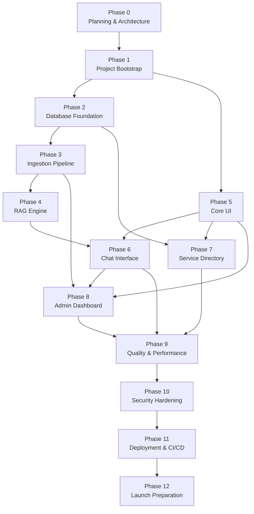

# Development Roadmap — Ask Bangladesh

> **Version:** 1.0.0  
> **Last Updated:** 2025-07-15  
> **Status:** Active  
> **Owner:** Core Team

---

## Table of Contents

- [1. Phase Overview](#1-phase-overview)
- [2. Maturity Levels](#2-maturity-levels)
- [3. Phase Details](#3-phase-details)
- [4. Phase Dependencies](#4-phase-dependencies)
- [5. Risk Register](#5-risk-register)
- [6. Timeline Estimates](#6-timeline-estimates)

---

## 1. Phase Overview

| Phase | Name | Prompts | Objective | Maturity |
|---|---|---|---|---|
| **0** | Planning & Architecture | P01–P05 | Define architecture, data models, project structure, and documentation | — |
| **1** | Project Bootstrap | P06–P10 | Initialize repository, configure tooling, set up development environment | — |
| **2** | Database Foundation | P11–P16 | Design and implement the PostgreSQL schema with pgvector support | — |
| **3** | Ingestion Pipeline | P17–P23 | Build Python crawlers, document processors, and embedding pipeline | DISCOVER |
| **4** | RAG Engine | P24–P29 | Implement retrieval-augmented generation with source citations | DISCOVER |
| **5** | Core UI — Layout & Navigation | P30–P34 | Build the mobile-first shell, navigation, and shared components | — |
| **6** | Chat Interface | P35–P40 | Implement the conversational AI interface with streaming responses | GUIDE |
| **7** | Service Directory | P41–P45 | Build browsable and searchable service directory pages | GUIDE |
| **8** | Admin Dashboard | P46–P50 | Create admin interface for source management and monitoring | GUIDE |
| **9** | Quality & Performance | P51–P55 | Optimize performance, add comprehensive tests, accessibility audit | — |
| **10** | Security Hardening | P56–P59 | Rate limiting, input validation, security headers, penetration testing | — |
| **11** | Deployment & CI/CD | P60–P63 | Set up CI/CD pipeline, staging/production environments, monitoring | — |
| **12** | Launch Preparation | P64–P68 | Content verification, beta testing, documentation, go-live | ASSIST |

---

## 2. Maturity Levels

Ask Bangladesh progresses through three maturity levels as features are built:

```
┌─────────────┐     ┌─────────────┐     ┌─────────────┐
│  DISCOVER   │────▶│    GUIDE    │────▶│   ASSIST    │
│             │     │             │     │             │
│ "Find info" │     │ "Follow     │     │ "Get help   │
│             │     │  steps"     │     │  completing" │
└─────────────┘     └─────────────┘     └─────────────┘
  Phases 3–4          Phases 5–8          Phases 9–12
```

| Level | Description | User Experience |
|---|---|---|
| **DISCOVER** | Knowledge base is populated and searchable. Users can find raw information about government services. | "I can search and find information about e-passports." |
| **GUIDE** | AI-powered Q&A and structured guides are available. Users receive step-by-step guidance. | "I can ask questions in Bangla and get clear steps with source links." |
| **ASSIST** | Production-hardened platform with monitoring, admin tools, and verified content. | "I trust this platform to give me accurate, up-to-date information." |

---

## 3. Phase Details

---

### Phase 0 — Planning & Architecture

| Property | Value |
|---|---|
| **Objective** | Define the complete technical architecture, data models, project structure, and foundational documentation before writing any application code. |
| **Prerequisites** | None |

#### Work Packages

| ID | Description | Deliverable |
|---|---|---|
| P01 | System architecture design — define component boundaries, data flow, technology choices, and deployment topology | `docs/ARCHITECTURE.md` |
| P02 | Database schema design — define all tables, relationships, indexes, and pgvector configuration | `docs/DATABASE_SCHEMA.md` |
| P03 | API design — define all API routes, request/response schemas, authentication, and error handling | `docs/API_REFERENCE.md` |
| P04 | Security architecture — threat model, authentication strategy, data protection, rate limiting design | `docs/SECURITY.md` |
| P05 | Product requirements, roadmap, deployment plan, and progress tracking documents | `docs/PRODUCT_REQUIREMENTS.md`, `docs/DEVELOPMENT_ROADMAP.md`, `docs/DEPLOYMENT.md`, `docs/CODEX_PROGRESS.md` |

#### Deliverables

- Complete architecture documentation
- Database schema design with ER diagram
- API reference with all endpoints specified
- Security architecture document
- Product requirements document
- Development roadmap (this document)
- Deployment guide
- Progress tracking document

#### Completion Gate

All five documents are complete, reviewed, and internally consistent. No contradictions between architecture, API design, and database schema.

---

### Phase 1 — Project Bootstrap

| Property | Value |
|---|---|
| **Objective** | Initialize the monorepo, configure all development tooling, and verify the development environment works end-to-end. |
| **Prerequisites** | Phase 0 (architecture decisions finalized) |

#### Work Packages

| ID | Description | Deliverable |
|---|---|---|
| P06 | Initialize Next.js 14+ project with TypeScript, pnpm, and project structure matching architecture | Configured Next.js project |
| P07 | Configure ESLint, Prettier, Husky, lint-staged, and commitlint | `.eslintrc.js`, `.prettierrc`, `.husky/`, `commitlint.config.js` |
| P08 | Configure Tailwind CSS with custom theme (Bangla typography, color system, spacing) | `tailwind.config.ts`, global CSS |
| P09 | Set up shadcn/ui component library with custom theme tokens | `components/ui/` directory |
| P10 | Configure testing framework (Vitest, Testing Library, Playwright) and write first smoke test | `vitest.config.ts`, `playwright.config.ts`, first test file |

#### Deliverables

- Working Next.js development server
- All linting and formatting tools configured
- Tailwind CSS with Bangla-optimized theme
- shadcn/ui components installed
- Test framework configured with passing smoke test
- `README.md` with setup instructions

#### Completion Gate

`pnpm dev` starts the development server. `pnpm lint`, `pnpm typecheck`, and `pnpm test` all pass. A "Hello World" page renders with correct Bangla typography.

---

### Phase 2 — Database Foundation

| Property | Value |
|---|---|
| **Objective** | Implement the PostgreSQL schema, set up Drizzle ORM, configure pgvector, and verify database operations work correctly. |
| **Prerequisites** | Phase 1 (project initialized) |

#### Work Packages

| ID | Description | Deliverable |
|---|---|---|
| P11 | Set up local PostgreSQL with pgvector via Docker Compose | `docker-compose.yml`, setup script |
| P12 | Configure Drizzle ORM with PostgreSQL adapter and connection pooling | `drizzle.config.ts`, `src/lib/db/` |
| P13 | Implement core schema — sources, documents, chunks, embeddings tables | Drizzle schema files, migration files |
| P14 | Implement service-related schema — services, agencies, categories tables | Drizzle schema files, migration files |
| P15 | Implement operational schema — feedback, crawl_runs, admin_users tables | Drizzle schema files, migration files |
| P16 | Write database integration tests and seed data scripts | Test files, seed script |

#### Deliverables

- Docker Compose setup for local PostgreSQL + pgvector
- Complete Drizzle ORM configuration
- All database tables implemented with migrations
- Seed data for development
- Database integration tests passing

#### Completion Gate

All migrations run cleanly on a fresh database. Seed data populates correctly. Integration tests pass for CRUD operations on all tables. pgvector similarity search returns results.

---

### Phase 3 — Ingestion Pipeline

| Property | Value |
|---|---|
| **Objective** | Build the Python-based pipeline that crawls government websites, processes documents, generates embeddings, and populates the knowledge base. |
| **Prerequisites** | Phase 2 (database schema ready) |

#### Work Packages

| ID | Description | Deliverable |
|---|---|---|
| P17 | Set up Python project structure with dependency management (Poetry/pip-tools) | `ingestion/` directory, `pyproject.toml` |
| P18 | Implement web crawler for government websites with polite crawling (robots.txt, rate limiting, retry logic) | `ingestion/crawlers/` |
| P19 | Implement document processors — HTML parser, PDF extractor, content cleaner | `ingestion/processors/` |
| P20 | Implement text chunking strategies — semantic chunking, overlap, metadata preservation | `ingestion/chunkers/` |
| P21 | Implement embedding generation using OpenAI API with batching and error handling | `ingestion/embeddings/` |
| P22 | Implement pipeline orchestrator — job management, status tracking, error recovery | `ingestion/pipeline.py` |
| P23 | Write integration tests and crawl the first source (e-passport) | Tests, initial knowledge base content |

#### Deliverables

- Complete Python ingestion pipeline
- Government website crawlers with polite crawling
- Document processing and chunking
- Embedding generation with OpenAI API
- Pipeline orchestration with job tracking
- Initial knowledge base populated (e-passport content)

#### Completion Gate

The pipeline successfully crawls epassport.gov.bd, processes the content, generates embeddings, and stores them in the database. The knowledge base contains at least 50 relevant chunks. Pipeline status is tracked in the database.

---

### Phase 4 — RAG Engine

| Property | Value |
|---|---|
| **Objective** | Implement the retrieval-augmented generation engine that answers user questions by retrieving relevant content and generating grounded responses. |
| **Prerequisites** | Phase 3 (knowledge base populated), Phase 2 (database ready) |

#### Work Packages

| ID | Description | Deliverable |
|---|---|---|
| P24 | Implement vector similarity search with pgvector — query embedding, top-K retrieval, relevance scoring | `src/lib/rag/retriever.ts` |
| P25 | Implement hybrid search — combine vector search with full-text search (BM25) for better recall | `src/lib/rag/hybrid-search.ts` |
| P26 | Implement prompt engineering — system prompts, context formatting, language detection, response formatting | `src/lib/rag/prompts.ts` |
| P27 | Implement LLM integration with streaming — OpenAI API client, streaming response handler, error handling | `src/lib/rag/llm.ts` |
| P28 | Implement source citation extraction — link AI responses to source documents, format citations | `src/lib/rag/citations.ts` |
| P29 | Write RAG evaluation tests — relevance scoring, hallucination detection, citation accuracy | `tests/rag/` |

#### Deliverables

- Vector similarity search with pgvector
- Hybrid search (vector + BM25)
- Prompt engineering for Bangla/Banglish/English
- Streaming LLM integration
- Source citation system
- RAG evaluation test suite

#### Completion Gate

The RAG engine answers questions about e-passport services in Bangla, Banglish, and English with source citations. At least 70% of a 50-question test set receives relevant, accurate answers. Streaming works correctly.

---

### Phase 5 — Core UI: Layout & Navigation

| Property | Value |
|---|---|
| **Objective** | Build the mobile-first application shell with navigation, shared components, and Bangla typography system. |
| **Prerequisites** | Phase 1 (project bootstrapped) |

#### Work Packages

| ID | Description | Deliverable |
|---|---|---|
| P30 | Implement root layout with Bangla font loading, theme provider, metadata | `app/layout.tsx`, font configuration |
| P31 | Build mobile-first navigation — header, mobile menu, breadcrumbs, footer | Navigation components |
| P32 | Implement shared UI components — loading states, error boundaries, empty states, toast notifications | `components/shared/` |
| P33 | Implement language-aware components — language detection hook, RTL support (future-proofing), Bangla number formatting | `src/lib/i18n/` |
| P34 | Build landing page with hero, service categories, and quick-start chat prompt | `app/page.tsx` |

#### Deliverables

- Complete application shell
- Mobile-first navigation
- Shared component library
- Language-aware utilities
- Landing page

#### Completion Gate

The application renders correctly on 360px screens. Navigation works on mobile and desktop. Bangla text renders with correct typography. The landing page loads within performance budgets (FCP < 2s on 3G).

---

### Phase 6 — Chat Interface

| Property | Value |
|---|---|
| **Objective** | Build the conversational AI interface that lets users ask questions and receive streaming, sourced answers. |
| **Prerequisites** | Phase 4 (RAG engine), Phase 5 (UI shell) |

#### Work Packages

| ID | Description | Deliverable |
|---|---|---|
| P35 | Implement chat API route with streaming — Edge runtime, request validation, rate limiting | `app/api/chat/route.ts` |
| P36 | Build chat UI — message list, input bar, typing indicator, message bubbles with Bangla support | `components/chat/` |
| P37 | Implement streaming response rendering — progressive text display, markdown rendering, code blocks | Streaming UI components |
| P38 | Implement source citation display — inline citations, expandable source cards, source metadata | Citation components |
| P39 | Implement feedback mechanism — thumbs up/down, error reporting, feedback API | Feedback components and API |
| P40 | Add multi-turn conversation support — context management, conversation reset, conversation limits | Conversation state management |

#### Deliverables

- Chat API with streaming responses
- Complete chat UI with Bangla support
- Source citation display
- User feedback mechanism
- Multi-turn conversation support

#### Completion Gate

Users can have a multi-turn conversation in Bangla, Banglish, or English. Responses stream in real-time with source citations. Feedback buttons work. The chat interface is fully functional on 360px screens.

---

### Phase 7 — Service Directory

| Property | Value |
|---|---|
| **Objective** | Build the browsable, searchable service directory with category pages, service detail pages, and step-by-step guides. |
| **Prerequisites** | Phase 5 (UI shell), Phase 2 (database with service data) |

#### Work Packages

| ID | Description | Deliverable |
|---|---|---|
| P41 | Build service category listing page — category cards, icons, service counts | `app/services/page.tsx` |
| P42 | Build service detail page — requirements, fees, steps, timeline, agency info, online portal links | `app/services/[slug]/page.tsx` |
| P43 | Implement service search — Bangla and English full-text search, autocomplete, search results page | Search components and API |
| P44 | Build agency pages — agency profile, services offered, contact info | `app/agencies/` |
| P45 | Implement step-by-step guide component — numbered steps, document checklist, progress tracking | Guide components |

#### Deliverables

- Service category listing
- Service detail pages
- Search functionality (Bangla + English)
- Agency directory pages
- Step-by-step guide component

#### Completion Gate

Users can browse services by category, search in Bangla and English, view detailed service pages with step-by-step guides, and access agency information. All pages meet performance targets.

---

### Phase 8 — Admin Dashboard

| Property | Value |
|---|---|
| **Objective** | Build the admin interface for managing sources, monitoring the ingestion pipeline, and reviewing user feedback. |
| **Prerequisites** | Phase 3 (ingestion pipeline), Phase 5 (UI shell), Phase 6 (feedback system) |

#### Work Packages

| ID | Description | Deliverable |
|---|---|---|
| P46 | Implement admin authentication — simple auth middleware, session management | `app/admin/` layout, auth middleware |
| P47 | Build source management UI — CRUD for sources, crawl trigger, source health | `app/admin/sources/` |
| P48 | Build crawler monitoring dashboard — job status, success/failure rates, error logs | `app/admin/crawler/` |
| P49 | Build feedback review UI — feedback list, filters, actions | `app/admin/feedback/` |
| P50 | Build system overview dashboard — stats, recent activity, health indicators | `app/admin/page.tsx` |

#### Deliverables

- Admin authentication system
- Source management interface
- Crawler monitoring dashboard
- Feedback review interface
- System overview dashboard

#### Completion Gate

Admin can log in, manage sources (add/edit/delete/re-crawl), view crawler job history and errors, review user feedback, and see system health at a glance. All admin routes are protected.

---

### Phase 9 — Quality & Performance

| Property | Value |
|---|---|
| **Objective** | Optimize application performance, improve test coverage, conduct accessibility audit, and ensure production readiness. |
| **Prerequisites** | Phases 6, 7, 8 (all features built) |

#### Work Packages

| ID | Description | Deliverable |
|---|---|---|
| P51 | Performance optimization — bundle analysis, code splitting, image optimization, font subsetting | Performance audit report, optimizations |
| P52 | Accessibility audit and remediation — WCAG 2.1 AA compliance, screen reader testing | Accessibility audit report, fixes |
| P53 | Comprehensive unit tests — achieve > 80% coverage on business logic | Test files, coverage report |
| P54 | End-to-end tests with Playwright — critical user journeys (ask question, browse services, admin login) | `e2e/` test files |
| P55 | Bangla language quality review — verify Bangla rendering, input handling, search accuracy | Language quality report |

#### Deliverables

- Performance-optimized application
- WCAG 2.1 AA compliance
- Comprehensive test suite (> 80% unit coverage)
- E2E tests for critical paths
- Bangla language quality verification

#### Completion Gate

Lighthouse Performance score ≥ 90 on mobile. Lighthouse Accessibility score ≥ 90. Unit test coverage > 80%. All E2E tests pass. Bangla rendering and input verified on target devices.

---

### Phase 10 — Security Hardening

| Property | Value |
|---|---|
| **Objective** | Harden the application against common web vulnerabilities, implement rate limiting, and conduct security testing. |
| **Prerequisites** | Phase 9 (application stabilized) |

#### Work Packages

| ID | Description | Deliverable |
|---|---|---|
| P56 | Implement rate limiting — per-IP and per-user limits, Redis-backed, configurable thresholds | Rate limiting middleware |
| P57 | Input validation and sanitization — all user inputs validated with Zod, XSS prevention, SQL injection prevention | Validation schemas |
| P58 | Security headers and CSP — implement all headers from DEPLOYMENT.md, test with security scanners | `vercel.json` security config |
| P59 | Security testing — OWASP Top 10 checks, dependency audit, secret scanning | Security audit report |

#### Deliverables

- Rate limiting system
- Input validation on all endpoints
- Security headers configured
- Security audit report with findings addressed

#### Completion Gate

No critical or high-severity security findings. Rate limiting prevents abuse. All inputs are validated. Security headers score A+ on securityheaders.com. Dependency audit shows no known vulnerabilities.

---

### Phase 11 — Deployment & CI/CD

| Property | Value |
|---|---|
| **Objective** | Set up the complete deployment pipeline — CI/CD with GitHub Actions, staging and production environments, monitoring, and alerting. |
| **Prerequisites** | Phase 10 (security hardened) |

#### Work Packages

| ID | Description | Deliverable |
|---|---|---|
| P60 | Set up GitHub Actions CI pipeline — lint, typecheck, test, build, integration tests | `.github/workflows/ci.yml` |
| P61 | Configure Vercel deployment — preview and production, environment variables, domain | Vercel project configuration |
| P62 | Set up monitoring and alerting — Sentry, UptimeRobot, Vercel Analytics, database monitoring | Monitoring configuration |
| P63 | Set up ingestion worker deployment — Railway/Render, Docker, cron scheduling | Ingestion deployment configuration |

#### Deliverables

- Complete CI/CD pipeline
- Preview and production deployment working
- Monitoring and alerting operational
- Ingestion worker deployed and scheduled

#### Completion Gate

CI pipeline runs on every PR. Preview deployments work automatically. Production deploys require manual approval. Monitoring catches simulated failures. Ingestion workers run on schedule.

---

### Phase 12 — Launch Preparation

| Property | Value |
|---|---|
| **Objective** | Verify content accuracy, conduct beta testing, finalize documentation, and execute the go-live checklist. |
| **Prerequisites** | Phase 11 (deployment ready) |

#### Work Packages

| ID | Description | Deliverable |
|---|---|---|
| P64 | Content verification — review all knowledge base content for accuracy, completeness, and freshness | Content audit report |
| P65 | Beta testing — recruit 10–20 beta testers, collect feedback, fix critical issues | Beta test report, bug fixes |
| P66 | Documentation finalization — README, API docs, deployment guide, contributing guide | Final documentation |
| P67 | Pre-launch checklist execution — go through every item in DEPLOYMENT.md Section 10 | Completed checklist |
| P68 | Go-live — deploy to production, verify, announce, monitor | Live production deployment |

#### Deliverables

- Verified knowledge base content
- Beta test report with issues addressed
- Complete documentation
- Executed pre-launch checklist
- Live production deployment

#### Completion Gate

All go/no-go criteria from DEPLOYMENT.md Section 11 are met. Production deployment is live and stable. Monitoring confirms healthy operation for 24 hours. Beta tester feedback is positive.

---

## 4. Phase Dependencies



### Critical Path

The longest dependency chain determines the minimum timeline:

```
Phase 0 → Phase 1 → Phase 2 → Phase 3 → Phase 4 → Phase 6 → Phase 9 → Phase 10 → Phase 11 → Phase 12
```

### Parallel Work Opportunities

The following phases can be worked on in parallel (with proper sequencing within each):

| Parallel Track A | Parallel Track B |
|---|---|
| Phase 2: Database | Phase 5: Core UI |
| Phase 3: Ingestion | Phase 7: Service Directory (partially) |
| Phase 4: RAG Engine | — |

> [!TIP]
> As a solo developer, true parallelism isn't possible, but understanding these tracks helps prioritize and interleave work efficiently. For example, when waiting for a long crawl job to complete during Phase 3, switch to Phase 5 UI work.

---

## 5. Risk Register

| ID | Risk | Probability | Impact | Mitigation | Contingency |
|---|---|---|---|---|---|
| **R01** | Government source availability — websites may block crawlers, change structure, or go offline | High | High | Polite crawling with proper User-Agent; cache all crawled content; design pipeline to handle failures gracefully | Manual content entry as fallback; use Wayback Machine archives; contact government digital teams |
| **R02** | Bangla NLP quality — AI models may produce poor-quality Bangla responses or misunderstand Banglish input | Medium | High | Use GPT-4o/4o-mini which have strong multilingual capabilities; extensive Bangla-specific testing; custom system prompts with Bangla examples | Provide English fallback option; collect user feedback to identify problem patterns; fine-tune prompts iteratively |
| **R03** | LLM cost management — API costs may exceed budget as usage grows | Medium | Medium | Default to GPT-4o-mini (10x cheaper); implement caching (semantic + exact); set hard daily spend limits; rate limit users | Implement spending caps with graceful degradation; evaluate open-source models (Mistral, Llama); reduce response length |
| **R04** | Legal/regulatory uncertainty — unclear whether scraping government sites is permissible; potential trademark/branding issues | Low | High | Content is publicly available information; platform clearly states it is not affiliated with government; no copyrighted content reproduction | Consult with legal counsel; pivot to manual content curation if scraping is challenged; rebrand if necessary |
| **R05** | Single developer bottleneck — all knowledge and development capacity is concentrated in one person | High | High | Comprehensive documentation; clean code with tests; modular architecture that allows future contributors; automated CI/CD reduces bus factor for operations | Prioritize ruthlessly; defer non-essential features; design for low maintenance overhead; document everything as if handing off |
| **R06** | Government content accuracy — crawled content may be outdated or incorrect on the source websites themselves | Medium | High | Display "last verified" dates; track source freshness; implement stale content alerts; allow user error reporting | Clearly communicate that information should be verified with the relevant government office; add disclaimers |
| **R07** | Performance on low-end devices — the application may not meet performance targets on target devices | Medium | Medium | Mobile-first design; aggressive bundle optimization; performance budgets in CI; test on real low-end devices | Progressive enhancement; reduce features on slow connections; server-side rendering for critical content |
| **R08** | Scope creep — temptation to add features beyond V1 scope | High | Medium | Strict adherence to PRD scope; phase-gated development; out-of-scope list explicitly documented | Regular scope reviews against PRD; defer new ideas to a "V2 ideas" backlog |
| **R09** | Embedding quality — vector embeddings may not capture Bangla semantic meaning well enough | Medium | Medium | Use multilingual embedding models (OpenAI text-embedding-3-small supports Bangla); test retrieval quality extensively; implement hybrid search (vector + BM25) as fallback | Experiment with alternative embedding models; increase chunk overlap; add keyword-based retrieval path |
| **R10** | Data freshness — government processes change frequently; knowledge base may become outdated | High | Medium | Automated periodic re-crawling; source health monitoring; stale content alerts; user feedback loop for reporting outdated info | Clearly display "last updated" dates; accept user corrections; prioritize high-traffic services for frequent updates |

---

## 6. Timeline Estimates

> [!WARNING]
> These estimates assume a **single developer** working on the project. They are rough estimates and will vary based on the developer's familiarity with the tech stack, unforeseen technical challenges, and available time commitment.

### Per-Phase Estimates

| Phase | Estimated Duration | Confidence | Notes |
|---|---|---|---|
| Phase 0 | 1–2 weeks | High | Documentation-focused; well-scoped |
| Phase 1 | 3–5 days | High | Mostly configuration; well-documented tools |
| Phase 2 | 1–2 weeks | High | Schema design is done in Phase 0; this is implementation |
| Phase 3 | 2–3 weeks | Medium | Crawling government sites may have unexpected challenges |
| Phase 4 | 2–3 weeks | Medium | RAG quality tuning can be time-consuming |
| Phase 5 | 1–2 weeks | High | Standard UI work with known components |
| Phase 6 | 2–3 weeks | Medium | Streaming + Bangla rendering requires careful testing |
| Phase 7 | 1–2 weeks | High | Data-driven pages; relatively straightforward |
| Phase 8 | 1–2 weeks | High | Admin UI is lower complexity |
| Phase 9 | 2–3 weeks | Medium | Performance and accessibility work can uncover surprises |
| Phase 10 | 1–2 weeks | High | Security measures are well-defined |
| Phase 11 | 1 week | High | CI/CD is well-documented |
| Phase 12 | 1–2 weeks | Medium | Beta testing timeline depends on tester availability |

### Total Estimate

| Scenario | Duration | Assumption |
|---|---|---|
| **Optimistic** | 14 weeks (~3.5 months) | Full-time dedication, no blockers |
| **Realistic** | 20 weeks (~5 months) | Part-time work, normal challenges |
| **Conservative** | 28 weeks (~7 months) | Part-time work, significant challenges |

### Milestone Targets

| Milestone | Target | Phase |
|---|---|---|
| Architecture complete | Week 2 | Phase 0 |
| First database query works | Week 4 | Phase 2 |
| First document crawled and embedded | Week 7 | Phase 3 |
| First AI-powered Q&A works | Week 10 | Phase 4 |
| First user-facing page renders | Week 12 | Phase 5 |
| Chat interface functional | Week 15 | Phase 6 |
| MVP feature-complete | Week 18 | Phase 8 |
| Production-ready | Week 22 | Phase 11 |
| **Launch** | Week 24 | Phase 12 |

---

> [!NOTE]
> This roadmap is a living document. It should be updated as phases are completed, new information emerges, or priorities shift. The `CODEX_PROGRESS.md` document tracks actual progress against this plan.
