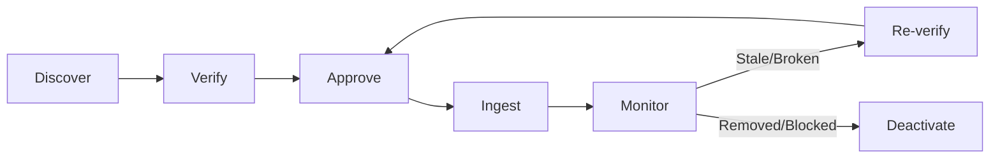

# Source Handling Policy

> **Project**: Ask Bangladesh — AI-Powered Government Services Assistant  
> **Classification**: Internal / Contributors  
> **Last Updated**: 2026-10-19  
> **Owner**: Core Team  
> **Review Cadence**: Monthly during active development, quarterly post-launch

---

## 1. Overview

Ask Bangladesh derives all of its factual knowledge from official government sources. The accuracy, reliability, and trustworthiness of the platform depend entirely on the quality and legitimacy of these sources. This document defines the policies, workflows, and rules governing how sources are discovered, verified, approved, crawled, cited, and maintained.

> [!IMPORTANT]
> Ask Bangladesh is an independent project and is **not** affiliated with the Government of Bangladesh. All source content is publicly available information accessed through standard web requests.

---

## 2. Source Approval Workflow

Every source progresses through a defined lifecycle before its content enters the knowledge base.



### 2.1 Stage: Discover

- Sources are identified through manual research, user requests, or systematic government website surveys.
- Any team member or contributor can propose a new source by creating a source proposal entry.
- The proposal includes:
  - Full URL(s) to be crawled
  - Government agency name
  - Content description (what services/information it covers)
  - Language(s) of content
  - Justification for inclusion

### 2.2 Stage: Verify

Verification confirms that the source meets all eligibility criteria (see §3) and can be ethically and technically crawled (see §5).

**Verification Checklist**:

- [ ] Domain is `.gov.bd` or a verified government domain
- [ ] Content is publicly accessible without authentication
- [ ] Content is relevant to government services
- [ ] `robots.txt` permits crawling of target paths
- [ ] No explicit prohibition of automated access in terms of service
- [ ] Content is in Bangla, English, or both
- [ ] Domain ownership confirmed (WHOIS or official government directory)
- [ ] Rate limit requirements identified (from `robots.txt` or server behavior)

### 2.3 Stage: Approve

- Approval requires action by an admin with `admin` or `super_admin` role.
- The approving admin reviews the verification checklist and signs off.
- Approval is recorded in the audit trail with:
  - Approver identity
  - Timestamp
  - Verification checklist status
  - Any conditions or notes (e.g., "Only crawl /services/ path")
- Approval can be conditional (limited to specific URL paths).

### 2.4 Stage: Ingest

- Approved sources are added to the crawl queue.
- The ingestion pipeline fetches, parses, chunks, embeds, and stores the content.
- Ingestion results are logged:
  - Pages fetched
  - Documents created
  - Errors encountered
  - Content hash for each document

### 2.5 Stage: Monitor

- Approved sources are periodically re-crawled on a configurable schedule (see §8).
- Monitoring detects:
  - Content changes (via content hash comparison)
  - Broken links (HTTP 404, 410, or connection failures)
  - Access changes (HTTP 403, new CAPTCHA, new authentication)
  - Domain changes (DNS failures, redirects to non-government domains)
- Issues trigger alerts for admin review.

### 2.6 Stage: Deactivate

- Sources that are no longer accessible, relevant, or compliant are deactivated.
- Deactivation does **not** delete existing documents from the knowledge base by default — they are flagged as stale.
- Deactivated sources can be re-activated if the issue is resolved.
- Deactivation is logged in the audit trail.

---

## 3. Domain Allowlist Criteria

Only domains that meet **all** of the following criteria are eligible for approval:

### 3.1 Must Be Government Domain

- Primary requirement: domain ends in `.gov.bd`.
- Exception: domains that are officially operated by the Government of Bangladesh but use a different TLD (e.g., certain project-specific domains). These require additional verification:
  - Listed in an official government directory or gazette
  - Referenced from multiple `.gov.bd` domains
  - Manual admin verification with documented evidence

### 3.2 Must Be Publicly Accessible

- Content must be accessible via standard HTTPS requests without:
  - User registration or login
  - API keys or authentication tokens
  - VPN or geo-restricted access
  - JavaScript-only rendering (content must be available in initial HTML or standard API responses)
- Content behind a login wall, paywall, or access restriction is **excluded** even if it is on a `.gov.bd` domain.

### 3.3 Must Not Require Authentication

- The target content (not the entire domain) must be accessible without authentication.
- If a government website has both public and authenticated sections, only the public sections are eligible.
- The crawler must never submit login credentials or session tokens.

### 3.4 Must Not Explicitly Prohibit Automated Access

- The domain's `robots.txt` must not disallow the paths being crawled for our user agent.
- The domain's terms of service (if available and reviewed) must not explicitly prohibit automated access to public content.
- If a domain returns HTTP 429 consistently even with polite crawl delays, we respect that signal and reduce or cease crawling.

---

## 4. Domain Allowlist Management

The domain allowlist is maintained as a configuration file in the repository and as records in the admin database.

### 4.1 Allowlist Structure

```typescript
interface ApprovedDomain {
  domain: string;                    // e.g., "www.services.gov.bd"
  agencyName: string;                // e.g., "a2i - Access to Information"
  agencyNameBn: string;              // e.g., "এটুআই - তথ্য অধিকার"
  allowedPaths: string[];            // e.g., ["/service/*", "/about"]
  blockedPaths: string[];            // e.g., ["/admin/*", "/login"]
  crawlDelaySeconds: number;         // Minimum delay between requests
  maxPagesPerCrawl: number;          // Maximum pages per crawl session
  lastApproved: string;              // ISO 8601 timestamp
  approvedBy: string;                // Admin user ID
  status: "active" | "paused" | "deactivated";
  notes: string;                     // Special instructions or conditions
}
```

### 4.2 Adding a Domain

1. Contributor creates a source proposal (issue or admin panel entry).
2. Reviewer completes the verification checklist (§2.2).
3. Admin approves and creates the allowlist entry.
4. Entry is deployed via code change (config file) or admin panel update.
5. First crawl is triggered manually to verify correctness.

### 4.3 Removing a Domain

1. Issue identified (domain blocked, content removed, policy violation).
2. Admin sets status to `deactivated`.
3. Existing documents from this domain are flagged as `stale`.
4. Stale documents remain available but display a warning:
   > "এই তথ্যের উৎস বর্তমানে অনুপলব্ধ। তথ্য পুরানো হতে পারে।"
   > ("The source of this information is currently unavailable. Information may be outdated.")
5. After **90 days** of deactivation, stale documents are archived (removed from active search index but retained in storage).

---

## 5. Content Extraction Rules

### 5.1 robots.txt Compliance

- Before any crawl, the crawler fetches and parses the domain's `robots.txt`.
- Disallowed paths are **never** crawled, regardless of their potential value.
- If `robots.txt` is unavailable (404), crawling proceeds with default polite behavior.
- If `robots.txt` is temporarily unavailable (5xx), crawling is deferred until `robots.txt` is accessible.
- The `Crawl-delay` directive is respected. If the site specifies a higher delay than our default, we use the site's value.

### 5.2 Polite Crawl Delays

| Scenario | Minimum Delay |
|---|---|
| Default (no `robots.txt` directive) | **5 seconds** between requests |
| `robots.txt` specifies `Crawl-delay` | Maximum of (`robots.txt` value, 5 seconds) |
| Server returns 429 | Exponential backoff starting at **30 seconds** |
| Server response time > 5 seconds | Increase delay to 2× server response time |
| Off-peak crawling (1:00–6:00 AM BDT) | Default delay applies (no special reduction) |

### 5.3 User-Agent Identification

The crawler identifies itself honestly:

```
User-Agent: AskBangladeshBot/1.0 (+https://askbangladesh.org/bot; contact@askbangladesh.org)
```

- The user agent string includes:
  - Bot name and version
  - URL to a page explaining the bot's purpose
  - Contact email for webmasters
- The user agent is **never** spoofed to impersonate a browser or another bot.

### 5.4 Strict Prohibitions

The following actions are **absolutely prohibited**:

| Action | Reason |
|---|---|
| CAPTCHA circumvention | Ethical violation, potential legal issue |
| Authentication bypass | Unauthorized access |
| Accessing restricted content | Content not publicly available |
| Ignoring `robots.txt` Disallow | Industry standard violation |
| Spoofing user agent | Deceptive practice |
| Crawling at high speed without delay | DoS risk to government servers |
| Scraping personal data from government sites | Privacy violation |
| Accessing content requiring payment | Not publicly available |
| Bypassing IP-based access controls | Unauthorized access circumvention |

### 5.5 Content Formats

The ingestion pipeline handles these formats from approved sources:

| Format | Handling |
|---|---|
| HTML pages | Parse, extract main content, strip navigation/boilerplate |
| PDF documents | Extract text, preserve structure (headings, lists, tables) |
| Downloadable forms (PDF) | Extract form field labels and instructions |
| Structured data (JSON/XML APIs) | Parse and map to document schema |
| Images with text | OCR if critical (future capability), otherwise skip |
| Video/Audio | Not ingested (link referenced only) |

---

## 6. Document Versioning

### 6.1 Content Hash Tracking

Every ingested document is identified by a content hash:

```
Document Identity:
  source_url:    https://www.services.gov.bd/service/passport-renewal
  content_hash:  sha256:a1b2c3d4e5f6...
  fetched_at:    2026-10-19T10:00:00Z
  version:       3
```

- The content hash is computed over the **extracted text content** (not raw HTML) to avoid false positives from cosmetic changes.
- Hash comparison determines whether a document has meaningfully changed.

### 6.2 Version History

- Each document maintains a version history:
  ```
  Version History:
    v1: 2026-09-01  sha256:abc123...  (initial)
    v2: 2026-09-15  sha256:def456...  (fee table updated)
    v3: 2026-10-19  sha256:ghi789...  (requirements section changed)
  ```
- Previous versions are retained in storage for audit and comparison purposes.
- The **latest version** is the active version used for retrieval and citation.
- A configurable retention policy governs how many old versions are kept (default: **10 versions** or **1 year**, whichever comes first).

### 6.3 Change Detection

On each re-crawl:

1. Fetch the page content.
2. Extract text using the same pipeline as initial ingestion.
3. Compute content hash.
4. Compare with the stored hash for the latest version.
5. If different:
   - Create a new version.
   - Re-chunk and re-embed the content.
   - Log the change with timestamp and hash delta.
   - If the change is in a critical field (fees, deadlines, requirements), flag for admin review.
6. If identical:
   - Update `last_verified_at` timestamp.
   - No new version created.

### 6.4 Staleness Monitoring

A document is considered **stale** when:

| Condition | Staleness Level | Action |
|---|---|---|
| Not re-verified in 30 days | Warning | Schedule priority re-crawl |
| Not re-verified in 60 days | Stale | Display staleness warning in citations |
| Not re-verified in 90 days | Critical | Flag for admin review, consider deactivation |
| Source URL returns 404/410 | Immediately stale | Deactivate source, flag documents |
| Source URL returns 403 | Possibly blocked | Pause crawling, alert admin |

---

## 7. Citation Requirements

Every piece of information presented to users must be traceable to a specific source. Citations are the foundation of trust.

### 7.1 Required Citation Fields

| Field | Required | Description |
|---|---|---|
| `sourceUrl` | **Yes** | Exact URL of the source page/document |
| `agencyName` | **Yes** | Name of the government agency (English) |
| `agencyNameBn` | **Yes** | Name of the government agency (Bangla) |
| `documentTitle` | **Yes** | Title of the page or document |
| `documentTitleBn` | Preferred | Title in Bangla (if available) |
| `passageText` | **Yes** | Relevant excerpt from the source |
| `pageNumber` | If PDF | Page number within PDF documents |
| `publicationDate` | If available | Date the content was published |
| `lastVerifiedAt` | **Yes** | Timestamp when the content was last verified by our crawler |

### 7.2 Citation Schema

```typescript
interface Citation {
  sourceId: string;           // Internal document ID
  sourceUrl: string;          // "https://www.brta.gov.bd/driving-license"
  agencyName: string;         // "Bangladesh Road Transport Authority"
  agencyNameBn: string;       // "বাংলাদেশ সড়ক পরিবহন কর্তৃপক্ষ"
  documentTitle: string;      // "Driving License Application Process"
  documentTitleBn?: string;   // "ড্রাইভিং লাইসেন্স আবেদন প্রক্রিয়া"
  passageText: string;        // Relevant excerpt text
  pageNumber?: number;        // Page number for PDF sources
  publicationDate?: string;   // ISO 8601 date
  lastVerifiedAt: string;     // ISO 8601 timestamp
  chunkId: string;            // Internal chunk ID for traceability
  contentVersion: number;     // Version of the document used
}
```

### 7.3 Citation Presentation Rules

**In Bangla responses**:
```
[তথ্যসূত্র: বাংলাদেশ সড়ক পরিবহন কর্তৃপক্ষ — "ড্রাইভিং লাইসেন্স আবেদন প্রক্রিয়া"
সর্বশেষ যাচাই: ১৯ অক্টোবর ২০২৬]
🔗 brta.gov.bd/driving-license
```

**In English responses**:
```
[Source: Bangladesh Road Transport Authority — "Driving License Application Process"
Last verified: 19 October 2026]
🔗 brta.gov.bd/driving-license
```

### 7.4 Citation Integrity Rules

- Every factual claim in an AI response must be tied to at least one citation.
- Citations are generated by the system based on which retrieved chunks contributed to the answer — not invented by the LLM.
- The LLM is instructed to reference source IDs; the system maps these to full citation objects.
- If the LLM generates a claim that cannot be mapped to a retrieved source, the claim is flagged as unsupported and the response includes an uncertainty warning.

---

## 8. Conflict Handling

### 8.1 Contradictory Sources

When two or more approved sources provide conflicting information on the same topic:

1. **Detection**: The system flags the conflict when:
   - Retrieval returns chunks with contradictory facts (detected via semantic similarity + factual divergence).
   - Admin manually flags a conflict during review.
   - User reports a discrepancy.

2. **Resolution Workflow**:
   ```
   Conflict Detected
     → Flag both documents
     → Admin notification
     → Admin review:
       a) Determine which source is authoritative
       b) Determine which source is more recent
       c) Mark the less authoritative/older source as superseded
       d) OR: escalate for further research
     → Update knowledge base
     → Log resolution
   ```

3. **User-Facing Behavior** (until resolved):
   - The AI response acknowledges the discrepancy:
     > "বিভিন্ন সরকারি সূত্রে এই বিষয়ে ভিন্ন তথ্য রয়েছে। সবচেয়ে সঠিক তথ্যের জন্য সরাসরি সংশ্লিষ্ট অফিসে যোগাযোগ করার পরামর্শ দেওয়া হচ্ছে।"
     > ("Different government sources have varying information on this topic. We recommend contacting the relevant office directly for the most accurate information.")
   - Both sources are cited with their respective dates.

### 8.2 Source Authority Hierarchy

When conflicts exist, authority is determined by:

1. **Recency**: More recently published or updated content is preferred.
2. **Specificity**: The agency directly responsible for the service is preferred over aggregator sites.
3. **Official gazette**: Gazette notifications supersede website content.
4. **Primary vs. secondary**: The originating agency's website supersedes references on other agencies' websites.

---

## 9. Source Freshness

### 9.1 Re-Crawl Schedule

| Source Category | Re-Crawl Frequency | Rationale |
|---|---|---|
| Fee tables & cost information | Weekly | Fees change frequently |
| Application procedures | Bi-weekly | Procedures update periodically |
| Office addresses & contacts | Monthly | Relatively stable |
| Legal/regulatory content | Monthly | Changes via gazette notifications |
| General informational pages | Monthly | Stable content |
| Newly approved sources | Daily (first 7 days) | Establish baseline and detect issues |

### 9.2 Broken Link Detection

- Every re-crawl checks the HTTP status of each source URL.
- Broken link responses are categorized:

| HTTP Status | Interpretation | Action |
|---|---|---|
| 200 | Accessible | Process normally |
| 301/302 | Moved | Update URL, verify content at new location |
| 403 | Forbidden | Pause, alert admin |
| 404 | Not Found | Mark stale, alert admin |
| 410 | Gone | Mark permanently removed, deactivate |
| 429 | Rate Limited | Back off, retry with increased delay |
| 500+ | Server Error | Retry 3 times over 24 hours, then alert |
| Timeout | Unreachable | Retry 3 times over 24 hours, then alert |

### 9.3 Stale Content Warnings

When a document is flagged as stale (see §6.4), the AI response includes a warning:

**Bangla**:
> ⚠️ এই তথ্যটি সর্বশেষ [তারিখ]-এ যাচাই করা হয়েছে এবং পুরানো হতে পারে। অনুগ্রহ করে সরাসরি সংশ্লিষ্ট অফিসে যোগাযোগ করে নিশ্চিত হোন।

**English**:
> ⚠️ This information was last verified on [date] and may be outdated. Please confirm directly with the relevant office.

---

## 10. Initial Candidate Sources

The following sources have been identified as candidates for the knowledge base. **All sources start as unverified and must pass the full approval workflow before ingestion.**

### 10.1 Primary Government Portals

| # | Domain | Agency | Description | Status |
|---|---|---|---|---|
| 1 | `www.services.gov.bd` | a2i / ICT Division | National e-service portal | 🔲 Unverified |
| 2 | `www.bangladesh.gov.bd` | Cabinet Division | National government portal | 🔲 Unverified |
| 3 | `www.mopa.gov.bd` | Ministry of Public Administration | Public admin services | 🔲 Unverified |

### 10.2 Identity & Documentation Services

| # | Domain | Agency | Description | Status |
|---|---|---|---|---|
| 4 | `www.nidw.gov.bd` | NID Wing, EC | National ID services | 🔲 Unverified |
| 5 | `www.dip.gov.bd` | Dept. of Immigration & Passports | Passport services | 🔲 Unverified |
| 6 | `www.brta.gov.bd` | BD Road Transport Authority | Driving license services | 🔲 Unverified |
| 7 | `bdris.gov.bd` | Office of Registrar General | Birth/death registration | 🔲 Unverified |

### 10.3 Revenue & Property Services

| # | Domain | Agency | Description | Status |
|---|---|---|---|---|
| 8 | `www.nbr.gov.bd` | National Board of Revenue | Tax services (TIN, VAT) | 🔲 Unverified |
| 9 | `www.land.gov.bd` | Ministry of Land | Land records & services | 🔲 Unverified |

### 10.4 Education & Examination

| # | Domain | Agency | Description | Status |
|---|---|---|---|---|
| 10 | `www.moedu.gov.bd` | Ministry of Education | Education policies | 🔲 Unverified |
| 11 | `www.educationboard.gov.bd` | Education Board | Exam results & certificates | 🔲 Unverified |

### 10.5 Legal & Judicial

| # | Domain | Agency | Description | Status |
|---|---|---|---|---|
| 12 | `www.judiciary.org.bd` | Supreme Court | Judicial services | 🔲 Unverified |
| 13 | `www.lawd.gov.bd` | Law & Justice Division | Legal information | 🔲 Unverified |
| 14 | `bdlaws.minlaw.gov.bd` | Legislative & Parliamentary Affairs | Laws of Bangladesh | 🔲 Unverified |

### 10.6 Other Essential Services

| # | Domain | Agency | Description | Status |
|---|---|---|---|---|
| 15 | `www.dghs.gov.bd` | Directorate General of Health Services | Health services | 🔲 Unverified |
| 16 | `www.bb.org.bd` | Bangladesh Bank | Banking regulations | 🔲 Unverified |
| 17 | `www.bida.gov.bd` | BD Investment Development Authority | Business registration | 🔲 Unverified |
| 18 | `www.rjsc.gov.bd` | Registrar of Joint Stock Companies | Company registration | 🔲 Unverified |
| 19 | `www.epb.gov.bd` | Export Promotion Bureau | Trade services | 🔲 Unverified |
| 20 | `www.dgfp.gov.bd` | Directorate General of Family Planning | Family planning services | 🔲 Unverified |

> [!NOTE]
> This list is a starting point. Sources will be verified and approved individually following the workflow defined in §2. The list will grow as new government services are identified and prioritized based on user demand.

---

## 11. Policy Enforcement

### 11.1 Compliance Monitoring

- This policy is enforced through:
  - Automated checks in the ingestion pipeline (domain allowlist, `robots.txt` compliance, crawl delays).
  - Admin review steps in the source approval workflow.
  - Periodic audits of crawl logs to verify compliance.

### 11.2 Policy Violations

If a violation of this policy is detected:

1. The offending crawl is immediately paused.
2. The incident is logged.
3. An admin reviews the violation and determines root cause.
4. Corrective action is taken (fix crawler bug, update configuration, etc.).
5. If content was ingested in violation, it is removed from the knowledge base.

### 11.3 Policy Updates

- Changes to this policy require `super_admin` approval.
- Significant changes (new domain criteria, extraction rule changes) are documented in the repository's changelog.
- All team members are notified of policy changes.
